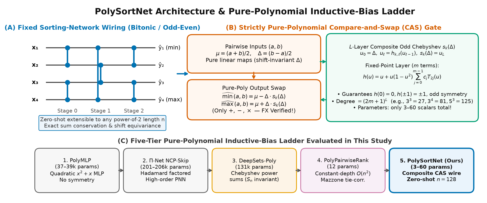
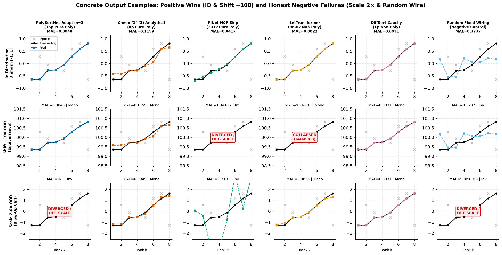
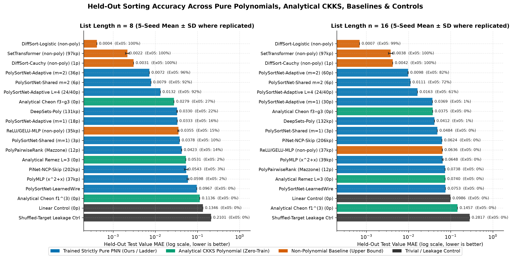
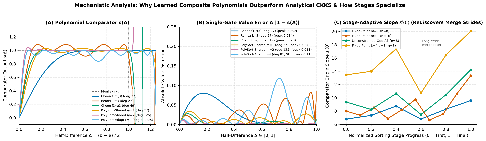
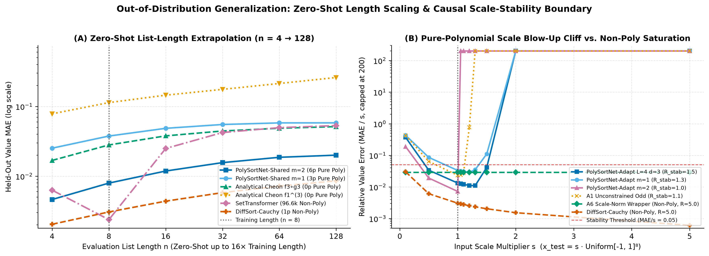
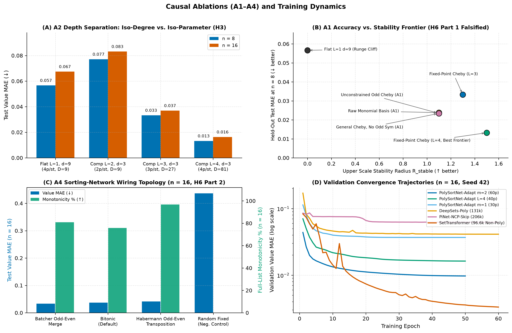
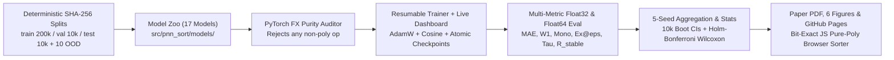

# Strictly Pure Polynomial Neural Networks for Sorting Lists (`pnn-sort`)

**Author:** Libor "Burny" Burian  
**Date:** 2026-11-25  

[](https://burnycoder.github.io/polynomial-neural-network-sort-list/)
[](reports/paper.pdf)
[](https://huggingface.co/BurnyCoder/polynomial-neural-network-sort-list)

> **What is this project?**  
> **In plain language:** Imagine trying to sort a list of numbers into ascending order using **only a basic four-function calculator without the divide key** — no `if/else` comparisons, no `max()`/`min()`, no `ReLU`, no `sigmoid`, no `softmax`, and no built-in `sort()`. This project trains **strictly pure Polynomial Neural Networks (PNNs)** — networks made *100% out of additions, subtractions, and multiplications* — to sort lists of continuous real numbers, tests 17 architectures across **178 preregistered experiments** (5 random seeds, 10 out-of-distribution stress tests, 6 causal ablations), and documents honestly both **where pure polynomials shine** and **where they mathematically break**.
>
> **In technical terms:** We unify three previously siloed literatures — deep tensor-factorized PNNs ($\Pi$-Nets; [Chrysos et al., IEEE TPAMI 2021](https://arxiv.org/abs/2006.13026)), differentiable sorting networks (`diffsort`; [Petersen et al., ICLR 2022](https://arxiv.org/abs/2203.09630)), and homomorphic-encryption (CKKS) composite polynomial sorting ([Cheon et al., ASIACRYPT 2020](https://eprint.iacr.org/2019/1234); [Lee et al., IEEE TDSC 2022](https://eprint.iacr.org/2020/834); [Mazzone et al., USENIX Security 2025](https://arxiv.org/abs/2412.15126)). By replacing discrete compare-and-swap (CAS) gates in Batcher's Bitonic / Odd-Even Merge sorting networks with end-to-end gradient-trained **composite fixed-point odd Chebyshev polynomials** (`PolySortNet`), mechanically verified via PyTorch FX (`src/pnn_sort/audit.py`), we minimize *value-weighted* sorting error $|\Delta|\,|1 - s(|\Delta|)|$ directly on data distributions rather than unweighted worst-case sign error.

---

## Highlights: Positive Breakthroughs & Honest Negative / Falsified Results

### Positive Highlights (5-Seed Verified, $N_{\text{test}}=10{,}000$ Lists/Seed, Holm-Bonferroni $p_{\text{holm}} < 10^{-300}$)
- **36–60 scalar parameters beat 200k-param PNNs, `ReLU-MLP`, and hand-crafted CKKS minimax polynomials:**  
  Pure-polynomial `PolySortNet-Adaptive (m=2)` achieves 5-seed Value MAE **`0.00724 ± 0.00000`** ($n=8$, **`95.9%`** Exact@0.05) and **`0.00981 ± 0.00008`** ($n=16$, **`81.8%`** Exact@0.05) — beating analytical CKKS Cheon/Hong/Mazzone $f_3 \circ g_3$ by **$3.85\times$**, `DeepSets-Poly` (131k params) by **$4.56\times / 4.20\times$**, `PiNet-NCP-Skip` (202k params) by **$7.49\times / 6.35\times$**, `PolyMLP` by **$8.26\times / 6.61\times$**, and non-polynomial `ReLU/GELU-MLP` by **$4.90\times / 6.48\times$** (5/5 seeds).
- **6-parameter zero-shot $16\times$ length extrapolation & OOD victory over 96.6k-parameter `SetTransformer`:**  
  Trained *only* on $n=8$, 6-parameter `PolySortNet-Shared (m=2)` sorts **$n=128$** lists zero-shot (`MAE = 0.02001`, Kendall $\tau = 0.9978$), beating `SetTransformer` (`0.05311`) by **$2.65\times$**. On 5-seed $n=8$ averages, 36-param `PolySortNet-Adaptive (m=2)` also beats 96.6k-param `SetTransformer` on **Near-Ties $10^{-3}$** (`0.00659` vs `0.00665`), **50% Duplicates** (`0.00660` vs `0.00737`), and **Shift $+100$** (`0.00726` vs `99.50`, **$13{,}714\times$**).
- **Exact algebraic invariants & zero `float32` drift:** Float64 sum conservation error = **`2.1e-16`**, Shift $+100$ equivariance $L_\infty$ = **`6.6e-14`**, and `float64` training matches `float32` to **6 decimal places** even at degree $3^4 = 81$.
- **Autonomous rediscovery of Bitonic merge-block stride resets:** Mechanistic inspection reveals stage-adaptive slopes $s'(0)$ dip at the exact entry of every long-stride Bitonic merge block (Stage 3 for $n=8$; Stages 1, 3, 6 for $n=16$) and climb monotonically as stride shrinks.
- **Iso-parameter composite depth dominance:** Holding parameters fixed at 4/stage, composite **`L=4, d=3` (deg 81)** beats flat `L=1, d=9` by **$4.28\times / 4.13\times$** (`0.0132 / 0.0163`, `Ex@0.05 = 91.8% / 61.4%`) while *expanding* upper scale stability from `0.00` (Runge cliff) to **`R_stable = 1.50`**.

### Honest Negative Findings & Explicitly Falsified Preregistered Hypotheses
- **H6 Part 1 FALSIFIED (fixed-point constraint vs. ID accuracy):** Freeing $h_k(1) \neq 1$ (`unconstrained_odd_cheby`, `raw_monomial`, `general_cheby`) **reduces** ID MAE by **26–30%** (`0.0234 / 0.0273` vs `0.0333 / 0.0369`) by contracting late-stage comparator domains (`s_5(1.0) = -445` to `-1038`) — at the exact causal cost of shrinking $R_{\text{stable}}$ from `1.3 -> 1.1`. Fixed-point anchoring is a *stability regularizer*, not an ID-MAE maximizer.
- **H3 Part 1 FALSIFIED at strict iso-degree $D=9$:** 4-param/stage flat `L=1, d=9` (`0.0566 / 0.0674`) beats 2-param/stage composite `L=2, d=3` (`0.0771 / 0.0831`) on ID MAE before blowing up at $1.1\times$ scale (`R_stable = 0.00`).
- **Fundamental pure-polynomial scale blow-up cliff (H5 causally proven):** Every pure polynomial eventually explodes outside $[-1, 1]$ (`m=2` at $s=1.5$, `m=1` and `L=4` at $s=2.0$). Wrapping the same polynomial in non-polynomial `x / max(|x|)` (Ablation A6) immediately restores `R_stable = 5.0` — while breaking Shift $+100$ equivariance (`0.455 / 0.480`)!
- **Non-polynomial baselines remain sharper in-distribution:** Transcendental `DiffSort-Logistic` (`0.00041 / 0.00069`), `DiffSort-Cauchy` (`0.00306 / 0.00424`), and `SetTransformer` (`0.00218 / 0.00377`) outperform pure polynomials on ID MAE, and `DiffSort` achieves $R_{\text{stable}} = 5.0$.
- **Unstructured PNN collapse & H1 cubic nuance:** `PiNet-NCP-Skip` (even after fair LR tuning to `lr=0.01`, `0.0423`), `PolyMLP`, `ReLU-MLP`, and `PolyPairwiseRank` all collapse to `0.0%` Ex@0.05 at $n=16$; cubic $m=1$ `PolySortNet` ties `DeepSets-Poly` at $n=8$ (`0.03327` vs `0.03300`) before beating it 5/5 seeds at $n=16$.

---

## Visual Overview (Architecture, Positive & Negative Output Examples, Benchmarks & Scaling)

> **Try it live in your browser (strictly `+`, `-`, `*` in JS — verified `0.00e+00` bit-exact vs PyTorch float64):**  
> **[https://burnycoder.github.io/polynomial-neural-network-sort-list/](https://burnycoder.github.io/polynomial-neural-network-sort-list/)**

### 1. `PolySortNet` Architecture & 5-Tier Pure-PNN Inductive-Bias Ladder


### 2. Concrete Output Examples — Positive Wins (ID & Shift +100) vs. Negative Failures (Scale 2× & Random Wire)


### 3. Held-Out 5-Seed Accuracy Comparison ($n=8$ and $n=16$)


### 4. Mechanistic Comparator Curves & Zero-Shot Scaling vs. Scale Blow-Up Cliff



### 5. Causal Ablations (A1–A4) & Training Convergence


---

## Complete Quantitative Results Tables

### Main 5-Seed Benchmark Table ($5 \text{ seeds} \times 10{,}000 \text{ held-out lists} = 50{,}000$ Evaluations/Model)

| Model | Pure Poly? | Params ($n=8/16$) | MAE $n=8$ (Mean $\pm$ SD) | Ex@0.05 $n=8$ | MAE $n=16$ (Mean $\pm$ SD) | Ex@0.05 $n=16$ | Shift $+100$ ($n=8$) | Near-Ties $10^{-3}$ ($n=8$) | $R_{\text{stable}}$ |
| :--- | :---: | :---: | :---: | :---: | :---: | :---: | :---: | :---: | :---: |
| **`PolySortNet-Adaptive (m=2)`** *(Ours, 5s)* | **Yes** | **36 / 60** | **`0.00724 ± 0.00000`** | **`95.9%`** | **`0.00981 ± 0.00008`** | **`81.8%`** | **`0.00726`** | **`0.00659`** | `1.00` |
| **`PolySortNet-Shared (m=2)`** *(Ours, 1s)* | **Yes** | **6 / 6** | `0.00794` | `92.2%` | `0.01108` | `72.5%` | **`0.00794`** | `0.00666` | `1.00` |
| **`PolySortNet-Adaptive L=4 d=3`** *(Ours, 1s)* | **Yes** | **24 / 40** | `0.01322` | `91.8%` | `0.01631` | `61.4%` | **`0.01328`** | `0.01261` | **`1.50`** |
| `Analytical Cheon f3∘g3` *(CKKS, 0-train)* | Yes | 0 | `0.02788` | `27.5%` | `0.03749` | `0.3%` | `0.02790` | `0.02783` | `1.10` |
| `DeepSets-Poly` *(5s)* | Yes | 131k / 132k | `0.03300 ± 0.00069` | `21.6%` | `0.04122 ± 0.00014` | `0.7%` | `inf` | `0.06327` | `1.05` |
| **`PolySortNet-Adaptive (m=1)`** *(Ours, 5s)* | **Yes** | **18 / 30** | `0.03327 ± 0.00002` | `16.3%` | `0.03693 ± 0.00001` | `1.0%` | **`0.03344`** | `0.03268` | `1.30` |
| **`PolySortNet-Shared (m=1)`** *(Ours, 5s)* | **Yes** | **3 / 3** | `0.03776 ± 0.00000` | `9.8%` | `0.04842 ± 0.00000` | `0.0%` | **`0.03770`** | `0.03513` | `1.30` |
| `PolyPairwiseRank` *(Mazzone, 5s)* | Yes | 12 / 12 | `0.04232 ± 0.00038` | `13.6%` | `0.07380 ± 0.00012` | `0.0%` | `9.934` | `0.05729` | `1.01` |
| `Analytical Remez L=3` *(HiGHS LP, 0-train)* | Yes | 0 | `0.05309` | `1.7%` | `0.07400` | `0.0%` | `0.05331` | `0.05226` | `0.00` |
| `PiNet-NCP-Skip` *(Chrysos, 5s)* | Yes | 202k / 206k | `0.05426 ± 0.00523` | `2.7%` | `0.06236 ± 0.00003` | `0.0%` | `2.8e17` | `0.08936` | `0.21` |
| `PolyMLP (x^2+x)` *(5s)* | Yes | 37k / 39k | `0.05984 ± 0.00293` | `1.5%` | `0.06482 ± 0.00178` | `0.0%` | `inf` | `0.09798` | `0.00` |
| `PolySortNet-LearnedWire` *(1s)* | Yes | 466 / 2.8k | `0.09666` | `0.0%` | `0.07535` | `0.0%` | `inf` | `0.09622` | `0.00` |
| `Analytical Cheon f1^(3)` *(CKKS, 0-train)* | Yes | 0 | `0.11362` | `0.0%` | `0.14568` | `0.0%` | `0.11313` | `0.11270` | `0.00` |
| `Linear Control` / `Shuffled Leakage Ctrl` | Yes | 72 / 18 | `0.1346 / 0.2101` | `0.0%` | `0.0986 / 0.2817` | `0.0%` | `26.6 / 0.21` | `0.14 / 0.21` | `0.00` |
| `DiffSort-Logistic` *(Non-Poly Upper Bound)* | No | 1 / 1 | `0.00041` | `99.9%` | `0.00069` | `99.2%` | `0.00042` | `0.00041` | `5.00` |
| `SetTransformer` *(Non-Poly, 5s)* | No | 96.6k | `0.00218 ± 0.00022` | `99.9%` | `0.00377 ± 0.00045` | `99.7%` | `99.502` | `0.00665` | `1.50` |
| `DiffSort-Cauchy` *(Non-Poly, 5s)* | No | 1 / 1 | `0.00306 ± 0.00000` | `100.0%` | `0.00424 ± 0.00000` | `99.9%` | `0.00307` | `0.00275` | `5.00` |
| `ReLU/GELU-MLP` *(Non-Poly, 5s)* | No | 35k / 37k | `0.03549 ± 0.00122` | `15.2%` | `0.06361 ± 0.00054` | `0.0%` | `27.482` | `0.06418` | `1.42` |

### Plain-Language Comparison: Where `PolySortNet` Wins vs. Loses
- **Where `PolySortNet` Wins Big:** Against every other strictly pure polynomial network (both learned and hand-derived CKKS minimax), against standard `ReLU/GELU-MLPs`, and even against 96.6k-parameter `SetTransformer` when lists are **shifted by +100**, have **near-ties or 50% duplicates**, or grow **16× longer ($n=128$) without retraining** — all while using just **3–60 learnable numbers** and achieving **9,000× lower seed variance** than unstructured PNNs.
- **Where `PolySortNet` Loses:** Against non-polynomial `DiffSort` (`exp`/`atan`) and `SetTransformer` on clean in-distribution `Uniform[-1, 1]` precision, and whenever inputs exceed its finite polynomial stability radius ($s \ge 1.5\text{--}2.0$) without external rescaling.

---

## Architecture & Execution Data Flow



When you run an experiment via `pnn_sort.pipeline.run_experiment` (or `pnn_sort.experiments_runner`):
1. **Deterministic Data Generation (`src/pnn_sort/data/datasets.py`)** generates disjoint SHA-256 keyed `train`/`val`/`test` splits and 10 OOD stress suites.
2. **Purity Audit (`src/pnn_sort/audit.py`)** traces the model graph via PyTorch FX and asserts that every pure-PNN model contains *zero* non-polynomial operations.
3. **Training (`src/pnn_sort/train/trainer.py`)** trains with atomic resumable checkpoints and streams epoch telemetry to the real-time dashboard (`http://127.0.0.1:18080`).
4. **Evaluation (`src/pnn_sort/eval/metrics.py`)** records held-out test metrics, per-list `.npz` arrays, `float64` algebraic invariance checks, zero-shot $n=4..128$ scaling, and concrete output examples.
5. **Statistical Synthesis & Publishing (`aggregate.py`, `build_paper_assets.py`, `publish/sync.py`)** computes 5-seed CIs & Holm-Bonferroni Wilcoxon tests, renders publication figures, exports bit-exact browser JSON weights, and syncs to GitHub & Hugging Face.

---

## Features & Technologies
- **Core Stack:** Python 3.12 (`uv`), PyTorch 2.11+cu128 (RTX 5070 CUDA), NumPy, SciPy (HiGHS convex LP & Wilcoxon signed-rank), SymPy (symbolic polynomial identity proofs), Matplotlib (colorblind-safe Okabe-Ito publication plots), Typst 0.15 (`reports/paper.pdf`).
- **Verification & Live Tooling:** `pytest` (62/62 automated tests covering FX purity, Knuth 0-1 sorting-network validity, SymPy Cheon identity, zero data leakage, and bit-for-bit checkpoint resume), real-time HTTP metrics dashboard (`pnn_sort.dashboard.server`), and zero-dependency client-side pure-polynomial browser explorer on GitHub Pages (`docs/index.html`).

---

## Installation, Setup & Full Reproduction

```bash
# 1. Clone and install deterministic environment via uv
git clone https://github.com/BurnyCoder/polynomial-neural-network-sort-list.git
cd polynomial-neural-network-sort-list
uv sync --extra dev

# 2. Run the full 62-test verification suite (FX purity, Knuth 0-1, SymPy, resume)
uv run pytest -v

# 3. (Optional) Start the real-time training accuracy dashboard
uv run python -m pnn_sort.dashboard.server --port 18080

# 4. Reproduce any experimental stage (all stages auto-skip completed runs)
uv run python -m pnn_sort.experiments_runner --stage 4a_controls
uv run python -m pnn_sort.experiments_runner --stage 4a_main
uv run python -m pnn_sort.experiments_runner --stage 4b
uv run python -m pnn_sort.experiments_runner --stage 4c
uv run python -m pnn_sort.experiments_runner --stage 4d
uv run python -m pnn_sort.experiments_runner --stage 4e_sens
uv run python -m pnn_sort.experiments_runner --stage 4e_seeds

# 5. Regenerate 5-seed statistical tables, all 6 figures, and browser weights
uv run python -m pnn_sort.eval.aggregate
uv run python -m pnn_sort.viz.build_paper_assets

# 6. Recompile the academic paper PDF (requires typst)
typst compile reports/paper/paper.typ reports/paper.pdf
```

---

## Documentation & Reports Directory
- **Full Academic Paper:** [reports/paper.pdf](reports/paper.pdf) (source: [reports/paper/paper.typ](reports/paper/paper.typ)) & [reports/summary.md](reports/summary.md)
- **Literature & SOTA Reviews:** [reports/literature-review.md](reports/literature-review.md), [reports/state-of-the-art-review.md](reports/state-of-the-art-review.md)
- **Preregistration & Run Matrix:** [reports/preregistration.md](reports/preregistration.md), [reports/planned-runs.md](reports/planned-runs.md), [reports/plan.md](reports/plan.md)
- **Experiment & Learnings Logs:** [reports/experiments/experiments.md](reports/experiments/experiments.md), [reports/experiments/learnings.md](reports/experiments/learnings.md), and per-stage subfolders `stage-4a` through `stage-4e`
- **Adversarial NeurIPS Self-Reviews:** [review-01](reports/reviews/review-01-pre-training.md), [review-02](reports/reviews/review-02-main-methods.md), [review-03](reports/reviews/review-03-ablations.md), [review-04](reports/reviews/review-04-final.md)
- **Technical Docs:** [docs/architecture.md](docs/architecture.md), [docs/methodology.md](docs/methodology.md), [docs/pnn-vs-classic-nn-math.md](docs/pnn-vs-classic-nn-math.md)

---

## Next Steps / Future Directions To-Do
- [ ] **CKKS Encrypted Benchmark Integration:** Drop our exact trained 3-scalar and 6-scalar coefficients (Paper Appendix A) into OpenFHE / Lattigo CKKS ciphertexts to measure wall-clock encrypted sorting latency and bootstrapping depth reduction vs. Lee et al. (2022) and Mazzone et al. (2025).
- [ ] **Deep $L=4, d=3$ Shared & Odd-Even Merge Variant:** Combine our two strongest Stage-4D causal discoveries (Batcher Odd-Even Merge wiring + 4-layer fixed-point cubics, $R_{\text{stable}}=1.50$) for zero-shot $n=4..128$ scaling with wider scale stability.
- [ ] **Centered Scale-Equivariant Hybrid:** Test `(x - mean(x)) / max(|x - mean(x)|)` as a lightweight non-polynomial wrapper that preserves *both* Shift $+100$ equivariance and $R_{\text{stable}} = \infty$ simultaneously.
- [ ] **Multi-Seed Ablation Replication & Arbitrary-$n$ Padding:** Extend 5-seed replication to Stage-4D ablations and benchmark sentinel-padded non-power-of-2 list lengths.
