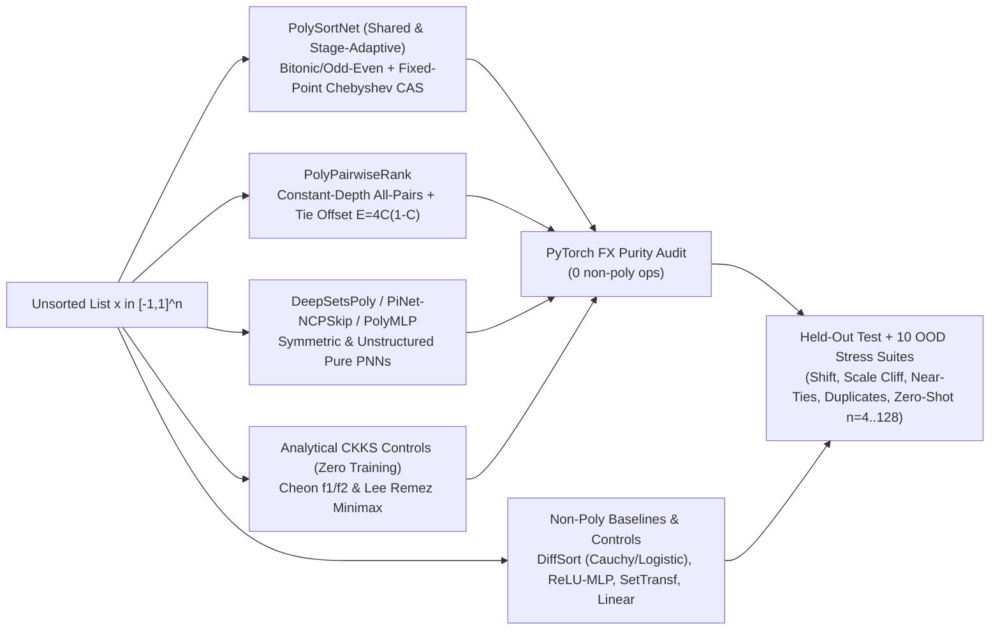

# Polynomial Neural Networks for List Sorting (`pnn-sort`)

> **Status:** Preregistration & Literature Review Complete (Pre-Results Commit — 2026-11-25). Experimental results, trained checkpoints, interactive visualizations, and `paper.pdf` will be populated incrementally as each staged run finishes.

**Author:** Libor "Burny" Burian  
**Primary Reports:** [Literature Review](reports/literature-review.md) · [SOTA Review](reports/state-of-the-art-review.md) · [Preregistration (Pre-Results)](reports/preregistration.md) · [Planned Run Matrix](reports/planned-runs.md) · [Live Progress](reports/progress.md)

---

## What Is This Project?

### In Plain Language (Layman's Summary)
Computers usually sort a list of numbers like `[0.8, -0.3, 0.1, -0.9]` using `if a > b: swap(a, b)` decisions. Standard neural networks approximate decisions using non-linear switches like `ReLU` or `sigmoid`. **Can a neural network learn to sort a list using *only* addition and multiplication — a pure mathematical polynomial — with zero `if` statements, zero comparisons, zero divisions, and zero standard activation functions?**

It turns out this is surprisingly subtle: exact sorting has sharp corners whenever two numbers cross (`max(a, b) = (a + b + |a - b|) / 2`), whereas polynomials are infinitely smooth curves. A single "flat" polynomial struggles badly unless its degree is huge. However, **stacking simple low-degree polynomials inside a sorting-network structure** creates an exponentially high-degree polynomial using just a handful of multiplications — letting a strictly pure polynomial neural network sort lists accurately, conserve the exact sum of the list, work automatically on shifted numbers, and even generalize zero-shot to lists $16\times$ longer than it ever saw during training. At the same time, pure polynomials have a mathematically guaranteed Achilles' heel: if input numbers grow too large outside the training range, any degree $>1$ polynomial must eventually blow up. This project builds, trains, tests, and visualizes both the breakthroughs and the exact failure boundaries.

### In Technical Terms (Expert Summary)
We conduct a preregistered, statistically rigorous empirical and theoretical investigation of **strictly pure Polynomial Neural Networks (PNNs)** $f_\theta : [-1, 1]^n \to \mathbb{R}^n$ (verified via automated PyTorch FX graph auditing to contain exclusively affine maps, additions, and multiplications) trained to approximate the order-statistics map $S(x) = (x_{(1)}, \dots, x_{(n)})$. Our study bridges three previously disconnected literatures:
1. **Deep Polynomial Neural Networks:** $\Pi$-Nets (CCP/NCP/NCP-Skip/ProdPoly; [Chrysos et al., CVPR 2020 / IEEE TPAMI 2021](https://arxiv.org/abs/2006.13026)) and polynomial-activation MLPs ([Kileel et al., NeurIPS 2019](https://arxiv.org/abs/1905.12207)).
2. **Symmetric Set Networks:** DeepSets ([Zaheer et al., NeurIPS 2017](https://arxiv.org/abs/1703.06114)) and latent-dimension bottlenecks ([Wagstaff et al., ICML 2019 / JMLR 2022](https://arxiv.org/abs/1901.09006)).
3. **Differentiable & Homomorphic Polynomial Sorting:** Differentiable Sorting Networks ([Petersen et al., ICML 2021](https://arxiv.org/abs/2105.04019); [ICLR 2022](https://arxiv.org/abs/2203.09630)) and CKKS composite polynomial sorting ([Cheon et al., ASIACRYPT 2020](https://eprint.iacr.org/2019/1234); [Lee et al., IEEE TDSC 2022](https://eprint.iacr.org/2020/834); [Mazzone et al., USENIX Security 2025](https://arxiv.org/abs/2412.15126)).

### Novelty & Key Scientific Questions
- **Fixed-Point Odd Chebyshev Composite CAS Parameterization:** $h_k(u) = u + u(1 - u^2)\sum_{j=0}^{m-1} c_{k,j} T_{2j}(u)$ mathematically preserves $h_k(0)=0, h_k(\pm 1)=\pm 1$, odd symmetry, exact sum conservation, exact shift equivariance, and range boundedness on $[-1, 1]$, while strictly subsuming Cheon et al.'s analytical $f_1, f_2, f_3$ polynomials.
- **Data-Trained vs. Analytical Minimax at Iso-Depth:** Tests whether gradient-trained shared and **stage-adaptive** `PolySortNet` models surpass zero-training analytical Cheon/Remez CKKS sorting networks at identical multiplicative depth and degree by optimizing value-weighted sorting error ($|\Delta||1-s(|\Delta|)|$) rather than unweighted sign error ($|1-s(u)|$).
- **Swap-Network vs. Constant-Depth All-to-All PNNs:** Benchmarks Bitonic/Odd-Even `PolySortNet` against a trainable Mazzone-inspired constant-depth `PolyPairwiseRank` PNN (with exact quadratic tie-correction $E = 4C(1-C)$), `DeepSetsPoly`, unstructured `PiNet-NCPSkip`, `PolyMLP`, and non-polynomial baselines (`DiffSort`, `ReLU-MLP`, `SetTransformer`).

---

## Architecture & Experimental Overview



---

## Planned Run Matrix Summary

Full specifications are locked in [reports/planned-runs.md](reports/planned-runs.md) and [reports/preregistration.md](reports/preregistration.md).

| Category | Models | Pure Poly? | Zero-Shot Length? | Status |
| :--- | :--- | :---: | :---: | :--- |
| **Main PNNs** | `PolySortNet-Shared` ($d=3, 5$), `PolySortNet-StageAdaptive` ($d=3, 5$), `PolySortNet-LearnedWire`, `PolyPairwiseRank`, `DeepSetsPoly`, `PiNet-NCPSkip`, `PolyMLP` | Yes | Shared & Pairwise: Yes | Planned (Stages 4A–4B) |
| **Analytical / Controls** | `AnalyticalCheonSort` ($f_1, f_2$), `AnalyticalRemezSort`, `LinearControl`, `IdentityControl`, `RandomInitControl`, `ShuffledTargetControl` | Yes | Analytical & Id: Yes | Planned (Stages 4A, 4C) |
| **Non-Poly Baselines** | `DiffSort-Logistic`, `DiffSort-Cauchy`, `ReLU-MLP`, `SetTransformer` | No | DiffSort & SetTransf: Yes | Planned (Stage 4C) |
| **Causal Ablations** | Parameterization (4), Iso-Degree Depth (4), Init (3), Wiring + Random-Wire Control (4), Loss (4), Scale-Norm Wrapper (2) | Mixed (A6 explicit) | — | Planned (Stage 4D) |
| **Statistical Rigor** | 5 seeds (`42, 123, 456, 789, 1024`) across 10 core models ($n=8, 16$) + LR/WD/batch/float64 sweeps | — | — | Planned (Stage 4E) |

---

## Installation & Setup

Requires Python 3.12+ and [`uv`](https://docs.astral.sh/uv/). Tested on Windows 11 with NVIDIA GeForce RTX 5070 Laptop GPU (`torch 2.11.0+cu128`).

```bash
git clone https://github.com/BurnyCoder/polynomial-neural-network-sort-list.git
cd polynomial-neural-network-sort-list
uv sync --python 3.12
uv run pytest -v
```

### Running Experiments & Live Accuracy Dashboard

```bash
# Run a single experiment (FX purity audit -> resumable training -> ID/OOD/float64/zero-shot eval)
uv run python -m pnn_sort.pipeline --run-id main_polysort_shared_n8_s42 --model polysort_shared --n 8 --seed 42

# Run an entire preregistered stage with the real-time web accuracy dashboard active
uv run python -m pnn_sort.experiments_runner --stage 4a_main --dashboard-port 8765

# Or run the live training dashboard standalone at http://127.0.0.1:8765
uv run python -m pnn_sort.dashboard.server --port 8765
```

### Data Flow When Running `pnn-sort`
1. **Pure-Polynomial Audit (`src/pnn_sort/audit.py`):** Traces the model via `torch.fx.symbolic_trace` and rejects any non-polynomial op before a single gradient step executes.
2. **Seed-Isolated Data Generation (`src/pnn_sort/data/`):** Generates deterministic SHA-256 keyed `train` ($200\text{k}$), `val` ($10\text{k}$), `test` ($10\text{k}$), and 10 held-out OOD stress suites ($2\text{k}$ each) with zero overlap.
3. **Resumable Training + Live Telemetry (`src/pnn_sort/train/`, `dashboard/`):** Runs AdamW + cosine schedule with gradient clipping, atomic per-epoch checkpointing (full RNG state resume), and live JSONL updates rendered at `http://127.0.0.1:8765`.
4. **Statistical Evaluation (`src/pnn_sort/eval/`):** Evaluates Value MAE, RMSE, $L_\infty$, Monotonicity Rate, Pairwise Order Accuracy / Kendall's $\tau$, Multiset $W_1$, Sum Conservation Error, Float64 precision verification, Scale Stability Radius $R_{\text{stable}}$, and Zero-Shot length generalization ($n = 4\text{--}128$), saving per-list arrays for 10,000-resample paired bootstrap CIs and Wilcoxon signed-rank tests.

---

## Technologies Used
- **Deep Learning & Symbolic Verification:** PyTorch (`cu128`), PyTorch FX symbolic tracing, SymPy
- **Numerical & Statistical Analysis:** NumPy, SciPy (Remez/minimax, Wilcoxon, Kendall's $\tau$), Pandas
- **Visualization & Publishing:** Matplotlib, Seaborn, Typst/LaTeX (`paper.pdf`), GitHub Pages (client-side interactive pure-polynomial sorter), Hugging Face Hub

---

## Roadmap (To-Do)
- [x] Phase 1: Full primary-source literature & state-of-the-art review
- [x] Phase 2: Preregistration, run matrix, documentation & pre-results GitHub commit
- [ ] Phase 3: Modular `src/pnn_sort/` codebase, FX purity tests, real-time training dashboard & Adversarial Review #1
- [ ] Phase 4: Staged training, controls, baselines, 6 ablation suites, 5-seed sweeps & incremental GitHub/HF sync
- [ ] Phase 5: Publication figures, interactive GitHub Pages explorer, `reports/paper.pdf` & Final Triple-Check
